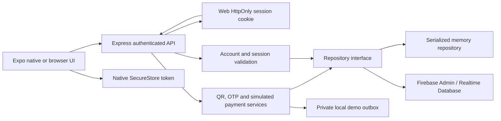

# NamPay architecture

NamPay is an Expo/React Native client and Express API for **simulated** NAD QR
payments. It has no spendable wallet balance, bank settlement or live card
processor. Home totals summarize completed simulation records. New card inputs
are predefined catalog IDs; the API rejects PAN and CVV fields.

This describes the implemented system through Phase 5. For exact request and
response fields, use [PAYMENTS_V2.md](../api/PAYMENTS_V2.md). The
[feature inventory](../implementation/FEATURE_INVENTORY.md),
[test matrix](../testing/TEST_MATRIX.md) and
[security decisions](../security/SECURITY_DECISIONS.md) describe scope and evidence.

## Components and trust boundaries

| Responsibility | Implementation |
| --- | --- |
| Authenticated navigation, four tabs, providers | [frontend/App.js](../../frontend/App.js) |
| Shared accessible controls, light/dark tokens | [components/ui](../../frontend/src/components/ui/index.js), [ThemeContext](../../frontend/src/context/ThemeContext.js) |
| HTTP transport, credential selection, safe errors, offline write guard | [config/api.js](../../frontend/src/config/api.js), [apiPolicy.js](../../frontend/src/config/apiPolicy.js) |
| Server factory, middleware, runtime isolation | [backend/server.js](../../backend/server.js) |
| Account identity and sessions | [authService.js](../../backend/services/authService.js), [middleware/auth.js](../../backend/middleware/auth.js) |
| QR signing, verification and lifecycle | [routes/qr.js](../../backend/routes/qr.js), [qrSignature.js](../../backend/services/qrSignature.js) |
| Bound verification and atomic completion | [otpService.js](../../backend/services/otpService.js), [paymentService.js](../../backend/services/paymentService.js) |
| Storage adapters and public projections | [repositories/index.js](../../backend/repositories/index.js), [paymentState.js](../../backend/services/paymentState.js) |

`createApp({repository, config})` constructs the API without starting a listener.
`startServer()` selects the configured repository and starts the loopback server.
Tests inject deterministic time and disposable repositories. The memory adapter
is permitted only in explicit local demos/tests. Firebase emulator mode requires
a loopback host, a `demo-` project and nonproduction demo configuration.

Clients do not access Firebase directly: the retained
[client Firebase module](../../frontend/config/firebase.js) initializes nothing,
and [database rules](../../backend/database.rules.json) deny direct reads and
writes, including Firebase-authenticated clients. The Admin SDK bypasses these
rules, so API ownership checks remain essential. Firebase Auth emulator checks
exercise rules and tooling; NamPay account login itself uses bcrypt and the
Express-issued JWT, not Firebase client authentication.

## Identity and local state

New accounts use a stable UID and a normalized-email index. Passwords use bcrypt;
new passwords require at least 12 characters and at most 72 UTF-8 bytes. The
server issues one-hour HS256 sessions and verifies issuer, audience, subject,
UID, issuance/expiry, session ID, account status and session version on protected
requests. Logout revokes the current session ID. Password change/reset increments
the account session version and requires a fresh sign-in.

Native clients store the bearer token in Expo SecureStore with
`WHEN_UNLOCKED_THIS_DEVICE_ONLY`. Browser login sets the `nampay_session`
HttpOnly, SameSite=Strict cookie, scoped to `/api`; it is Secure in production.
Browser responses omit the bearer token and Axios sends credentials. Exact
allowed-origin checks protect cookie-authenticated mutations. Nondevelopment
API configuration requires HTTPS; no refresh-token protocol is implemented.

[AuthContext](../../frontend/src/context/AuthContext.js) verifies the server
session at startup and on foreground resume. A temporary resume failure can
retain an already verified, unexpired screen; a 401 or local expiry removes the
protected navigation state. A nonsensitive pending-logout flag prevents a failed
browser logout from silently reviving its cookie on restart.

| Client data | Lifetime |
| --- | --- |
| Native session token | SecureStore until expiry/logout; startup still verifies the server |
| Browser session | Server cookie; no JavaScript-persisted token |
| Appearance, onboarding, pending logout | Allowlisted device preferences in AsyncStorage |
| Optional biometric/MFA/notification preferences | Allowlisted account-scoped preference keys |
| Profile cache, request/activity/inbox views | Memory; auth teardown/account changes discard private views |
| OTP input, confirmation body, idempotency key | Current payment flow in memory; no durable offline payment queue |
| Exported receipt/QR | Only after an explicit share/save action; QR native cache files are deleted after sharing |

Preference storage rejects the legacy `authToken` key. Unknown compatibility
cache keys stay in memory. UI data and connectivity hints never authorize a
payment. The server remains the source of current amounts, ownership and status.

## Request, verification and completion

1. The requester submits integer `amountMinor`, NAD, optional reference/note and
   a TTL. Requests allow 1–1,000,000 cents; the UI uses five minutes and the API
   accepts 60–300 seconds. No recipient card is needed to create a request.
2. The server creates the request and an HMAC-signed envelope containing version,
   type, request ID and expiry. Amount and recipient are loaded from the server,
   not taken from the scanned image. Camera and local-image import use the same
   signed `/qr/scan` validation; a successful scan records an access grant for
   that payer and request expiry.
3. Review reloads the request and owned eligible test instruments. The requester
   cannot pay their own request. Expired, cancelled or completed requests cannot
   be approved again.
4. OTP issuance binds the actor, `payment_verification` purpose, request, integer
   amount and expiry. Random six-digit codes have a 60-second resend cooldown,
   rate limits and at most five failed attempts. The database stores a keyed
   challenge hash. Resend supersedes older sessions. A native biometric prompt
   is optional local confirmation and never replaces server verification.
5. Confirmation sends request ID, card ID, verified session ID and one stable
   idempotency key. One repository transaction rechecks eligibility, consumes
   verification, completes the request, and writes the canonical transaction,
   opposing participant projections and deduplicated payment notifications.

The same service handles `/qr/confirm-payment` and
`/payments/process-payment`. A retry with the same actor/request/card/session/key
returns the original transaction. A conflicting operation cannot settle the
request twice. Cancellation competes at the same transaction boundary.

There is no remote charge inside the transaction callback and no partial bank
settlement to repair. IDs and timestamps are generated before retryable callbacks.
The Firebase adapter retains its root listener until commit; the memory adapter
serializes commits. **Whole-database transactions are a small-prototype
tradeoff**, with contention and scaling costs; they are not a production payment
architecture.

Mock OTP and local password recovery deliver secrets only to restricted local
outbox files, never public API responses or logs. The mock provider requires an
explicit local demo/memory or emulator configuration. Recovery returns a generic
response and needs the private, expiring, one-use token. Real email/SMS delivery
and live financial integrations have not been enabled or verified.

## Server records and compatibility

| Root path | Purpose |
| --- | --- |
| `users/<uid>`; `users/<uid>/cards` | Canonical account, password hash, preferences/photo and masked synthetic instruments |
| `emailIndex/<SHA-256 of normalized email>` | Stable UID lookup; avoids lossy email-derived account identity |
| `revokedSessions/<jti>`; `passwordResets/<token hash>` | Session revocation and one-use recovery proof |
| `paymentRequests/<id>` | Requester, amount, expiry and terminal outcome |
| `requestAccess/<requestId>/<uid>` | Signed-scan grant tied to request expiry |
| `otpSessions/<id>`; `otpRateLimits/<scope hash>` | Bound verification lifecycle and rate-limit counters |
| `transactions/<id>` | Canonical completed simulation and private idempotency fingerprint |
| `paymentOperations/<payerUid>/<key hash>` | Atomically bound operation fingerprint, request and canonical transaction; rejects changed details for a committed key |
| `userTransactions/<uid>/<id>` | Atomically written participant projection |
| `notifications/<uid>/<eventType_requestId>` | Deduplicated in-app events and server read timestamp |
| `migrations/users/<uid>` | Audit metadata for a verified legacy account copy |

History reads currently derive authorized views from canonical/historical
`transactions` records, deduplicated by transaction ID. Canonical payer/requester
membership overrides a legacy `userId`; an old owner field cannot grant an
outsider access. Public projections exclude verification hashes, private
operation fingerprints and unnecessary contact data. Summary totals count only
completed/succeeded simulations and use integer cents, not display floats.

A verified legacy login can copy an email-keyed account to its original UID path
without deleting the old record. Ambiguous email identities are rejected. Legacy
transaction records remain readable with explicit legacy metadata. Masked legacy
cards remain removable but need replacement by a valid catalog instrument before
payment. Card mutations normalize one default whenever cards remain; an empty
list has no default, and inconsistent older flags are disclosed instead of
inventing a client default.

Compatibility includes the `QR` navigation alias, `/qr/history`, selected older
card-ID field names and short-lived legacy signed envelopes. These aliases still
use current server authorization. Unbound amount/recipient-only payments and
legacy unbound OTP sessions cannot bypass the request-bound flow.

## Refresh, uncertain results and notifications

Focused request/activity screens refresh on focus, foreground resume and
reconnection; sequence guards reject obsolete reads. Lists replace/deduplicate
server records rather than appending repeated refresh results. Home keeps its
summary, pending requests and latest five activities independently loadable.

Network state is an in-memory hint from browser events and API/health results.
Known disconnection rejects writes before transport, while reads and foreground
health probes can establish recovery. Writes are never queued or automatically
replayed. A request definitely blocked before transport remains editable; an
ambiguous creation directs the user to existing requests. Card mutations reread
the server list before claiming success and preserve uncertain results until a
check is possible.

The payment controller retains an immutable confirmation body/key throughout an
active flow. Lost verification responses inspect the bound session; lost payment
responses reload the request/transaction. Only a verified canonical participant
transaction produces a completed result. Explicit retries use the original key.
After process loss, the client reloads server records rather than restoring an
OTP or blindly replaying a persisted intent.

The inbox is an owned, safe projection of created/expired/payment events. Reads
reconcile due owned expiries transactionally. A foreground-only 30-second poll,
resume and reconnection refresh update the inbox. UID/generation guards clear it
on logout and reject late responses. Read markers reconcile server timestamps;
notification preferences suppress badges while retaining inbox/history. Opening
an event reloads an authorized request or transaction screen. There is no push
registration, push provider or notification-based payment authority.

## Evidence boundaries

[Emulator checks](../testing/EMULATORS.md) exercise real RTDB transactions,
concurrent settlement, application startup and direct-client rules.
[Browser feature](../testing/FEATURES.md), [scanner](../testing/SCANNER.md) and
[reliability](../testing/RELIABILITY.md) checks cover the simulated user journey,
including a lost confirmation response. [Screenshots](../design/SCREENSHOTS.md)
are synthetic browser captures, not native-device evidence.

Native SecureStore restart, physical camera/gallery behavior, biometric
hardware, OS share sheets, native font scaling and TalkBack/VoiceOver remain
unverified. Production security review, provider delivery, deployment and live
money capability are outside the demonstrated result.
